# Climate Change Data Analysis

Climate Data Analysis using Python, Pandas, NumPy, Matplotlib and Jupyter Notebook.

## 1. Introduction

Climate change is one of the major environmental concerns around the world. Analysing climate-related data helps us explore variations in temperature, rainfall, humidity, wind speed, CO₂ levels and extreme weather conditions.

This project uses Python to clean, process, analyse and visualise climate data collected from 20 different locations over the years 2024 and 2025.

## 2. Problem Statement

The project aims to explore climate-related measurements across different locations and time periods. The analysis focuses on identifying variations, observing patterns and understanding relationships between different climate variables.

## 3. Questions Answered

1. Which locations recorded the highest and lowest average temperatures?
2. How does average rainfall vary across different locations?
3. How do average temperature and rainfall change across months?
4. Which extreme weather conditions occur most frequently in the dataset?
5. How are humidity and wind speed distributed?
6. What variations can be observed in the recorded CO₂ values?
7. Is there an observable relationship between temperature, rainfall and CO₂ measurements?
8. What patterns and relationships can be identified using a correlation heatmap?

## 4. Dataset

The dataset contains 240 records collected from 20 different locations over the years 2024 and 2025.

It includes climate-related information such as temperature, rainfall, humidity, wind speed, CO₂ levels and extreme weather conditions.

- **Raw dataset:** `data/raw/climate_change_new1.csv`
- **Processed dataset:** Stored in the `data/processed/` folder.

## 5. Project Structure

```text
Climate_Change_Analysis_Project/
│
├── data/
│   ├── raw/
│   └── processed/
│
├── notebooks/
│   └── data_analysis.ipynb
│
├── images/
│   └── 14 visualisation graphs
│
├── scripts/
│   └── data_handling.py
│
├── requirements.txt
├── .gitignore
└── README.md
```
## 6. How to Run

Follow these steps to run the project on your system.

**1. Clone the repository**

```bash
git clone https://github.com/kartikchoudhary1721/kartik2026B01010270
```

**2. Navigate to the project folder**

```bash
cd kartik2026B01010270
```

**3. Install the required libraries**

```bash
pip install -r requirements.txt
```

**4. Run the Jupyter Notebook**

```bash
jupyter notebook
```

Open `notebooks/data_analysis.ipynb` in Jupyter Notebook.

**Alternatively, run the Python script from the project root:**

```bash
python scripts/data_handling.py
```

## 7. Steps Followed

1. Imported the required Python libraries.
2. Loaded the raw climate dataset.
3. Examined missing values and inconsistent entries.
4. Cleaned humidity values by removing percentage symbols and converting them into numeric values.
5. Standardised wind speed values into km/h.
6. Handled missing values using median-based imputation.
7. Converted the date column into datetime format.
8. Checked for duplicate records and standardised location names.
9. Performed Exploratory Data Analysis (EDA).
10. Created visualisations using Matplotlib.
11. Exported the cleaned dataset into an Excel file.

## 8. Key Findings

The analysis revealed several interesting patterns in the climate dataset:

- **Highest Average Temperature:** Indonesia recorded the highest average temperature of approximately 30.97°C.
- **Lowest Average Temperature:** Russia recorded the lowest average temperature of approximately 5.25°C.
- **Rainfall:** Average rainfall varied across the 20 locations.
- **Extreme Weather:** Storms, floods, droughts, heatwaves and heavy rain were among the recorded extreme weather conditions.
- **Humidity and Wind Speed:** Both variables showed variations across the dataset.
- **Climate Relationships:** Visualisations and correlation analysis helped explore relationships between temperature, rainfall, humidity and CO₂ levels.

These findings are based on the dataset used in this project.

## 9. Visualisations

The project includes 14 visualisations created using Matplotlib to explore different aspects of the climate dataset.

### 1. Average Rainfall by Location
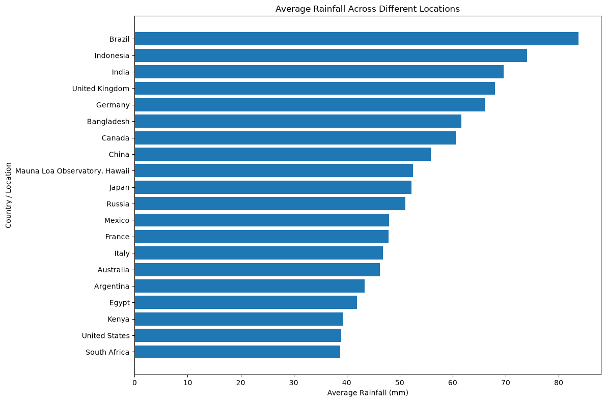

### 2. Average Temperature Distribution
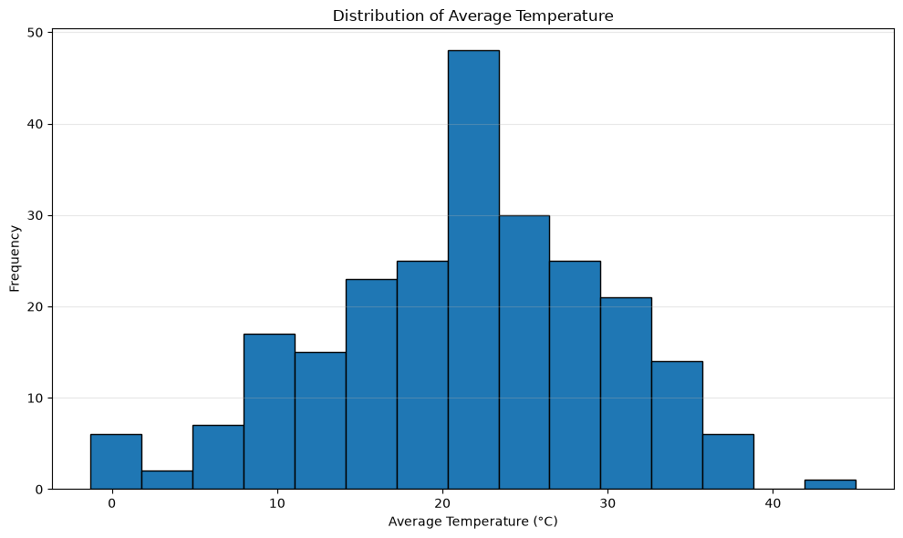

### 3. Average Temperature by Location
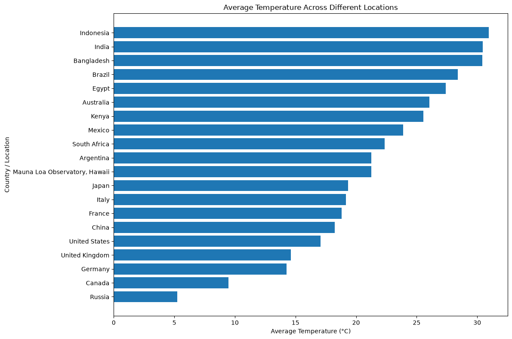

### 4. Average Temperature Box Plot
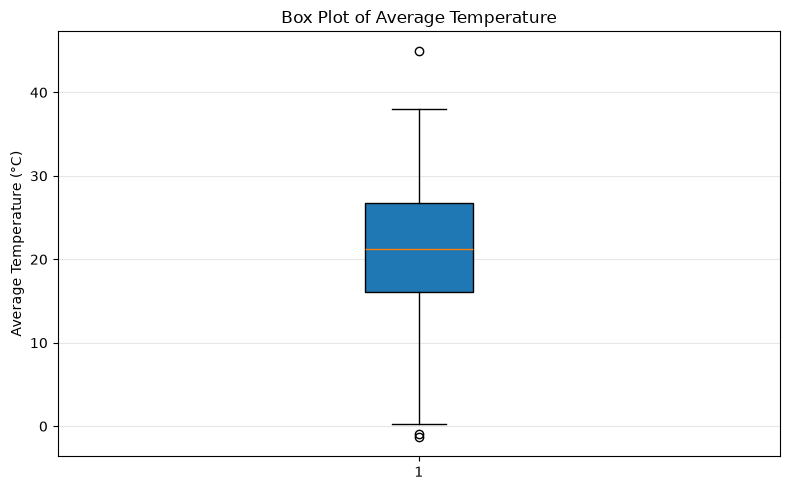

### 5. CO₂ Levels vs Average Temperature
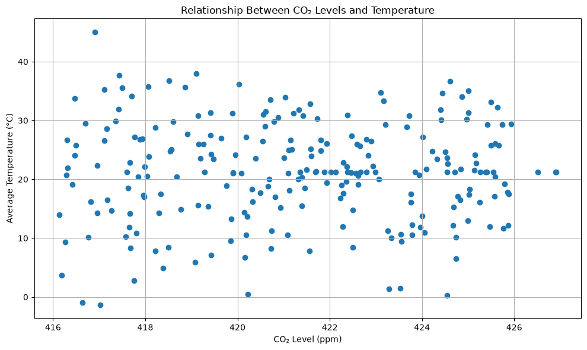

### 6. Correlation Heatmap


### 7. Date vs CO₂ Levels
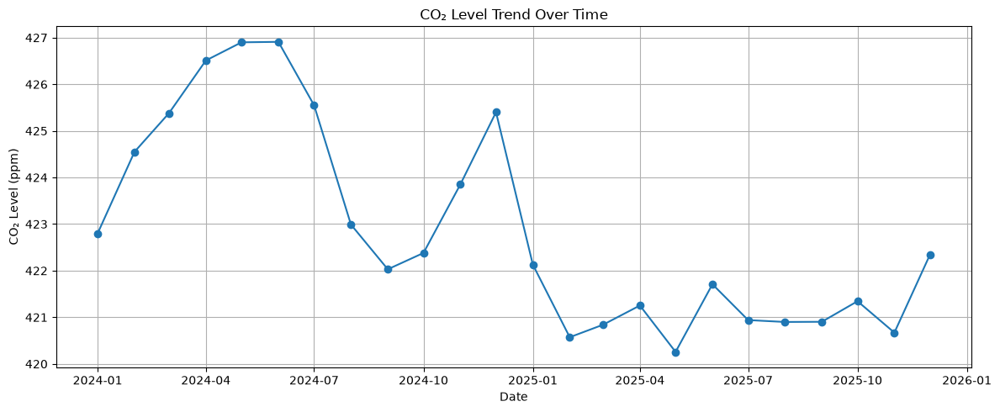

### 8. Frequency of Extreme Weather Conditions
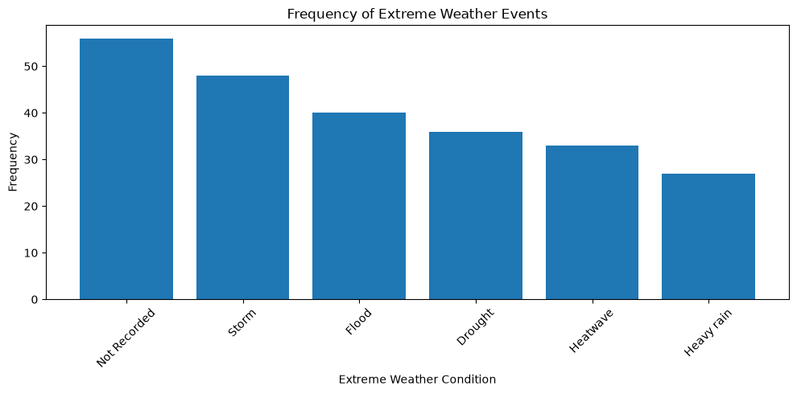

### 9. Humidity Distribution
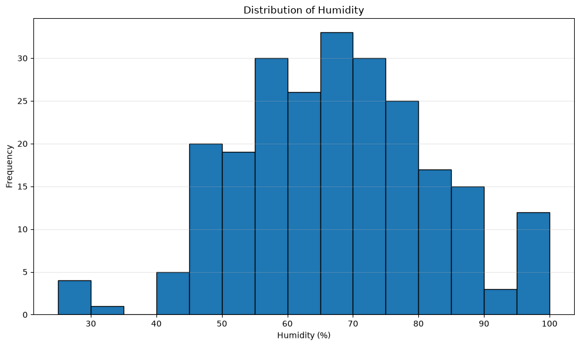

### 10. Humidity vs Rainfall
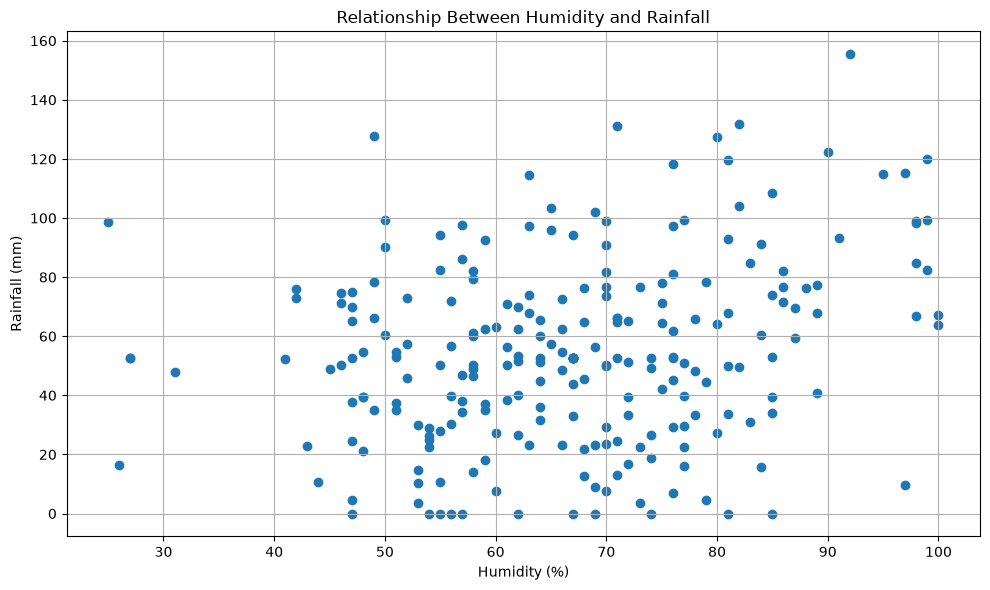

### 11. Month vs Average Rainfall
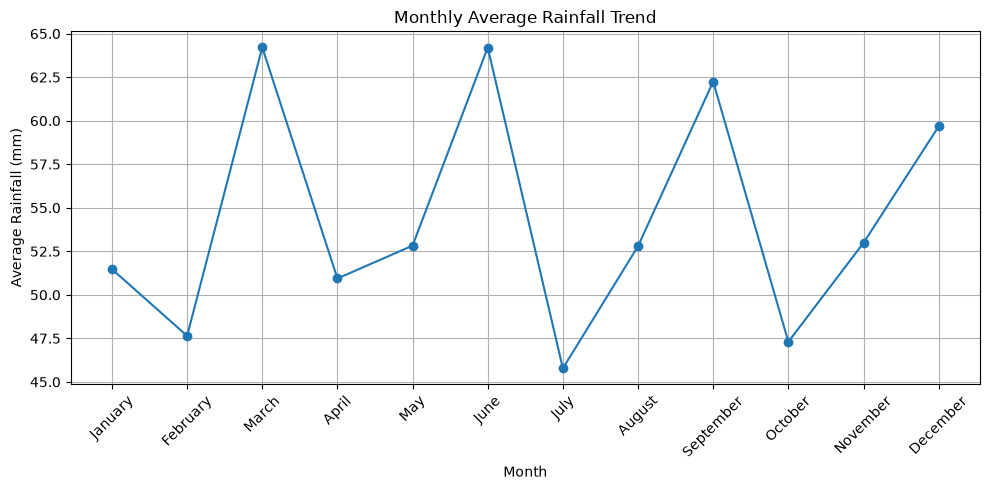

### 12. Month vs Average Temperature
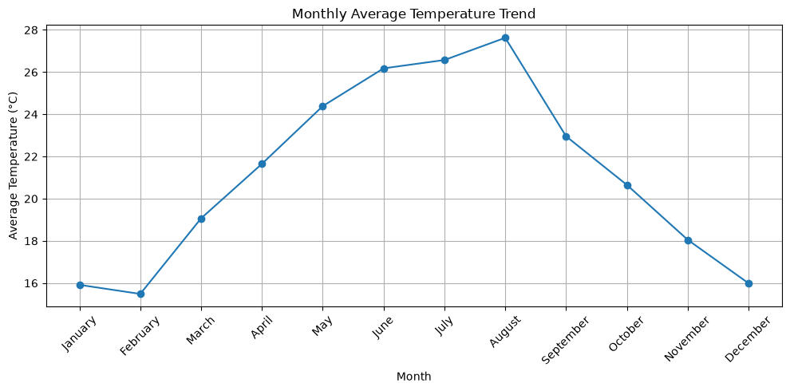

### 13. Rainfall Distribution
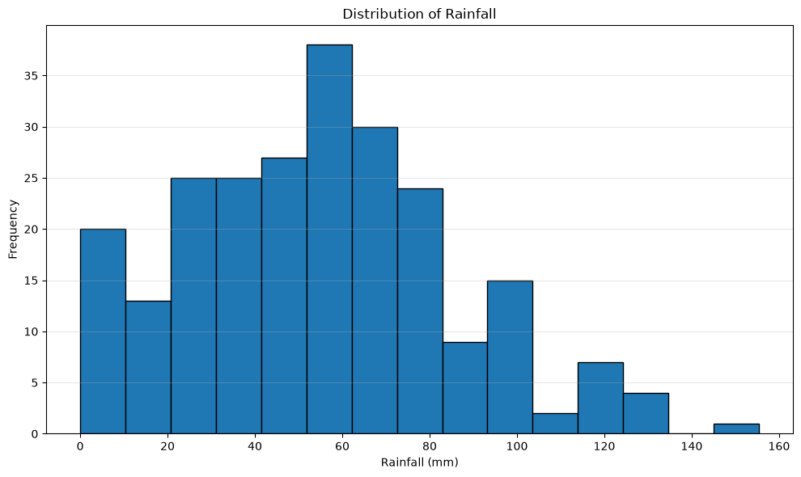

### 14. Wind Speed Distribution
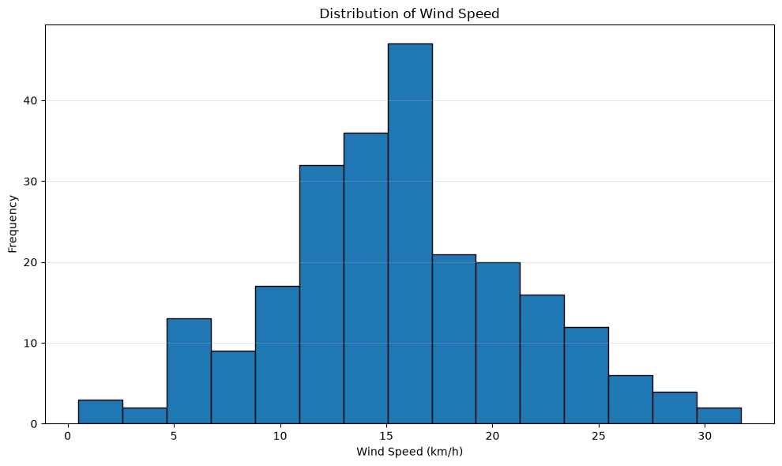

## 10. Tools and Technologies

The following tools and libraries were used in this project:

- **Python** – Programming language
- **Pandas** – Data cleaning and manipulation
- **NumPy** – Numerical operations
- **Matplotlib** – Data visualisation
- **Jupyter Notebook** – Data analysis and documentation
- **OpenPyXL** – Excel file handling

## 11. Author

**Kartik Choudhary**

GitHub: [kartikchoudhary1721](https://github.com/kartikchoudhary1721)
